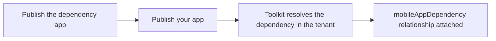

# App dependencies

Some apps need something else installed **first**. Most commonly a **Visual C++ redistributable**, or
another in-house app. Declare it, and the toolkit does two things:

1. **In Intune**: creates a real `mobileAppDependency` relationship, so the Intune Management Extension
   installs the dependency **before** your app on the device.
2. **In your test runs**: installs the dependency **inside the Sandbox / Hyper-V guest before the app**, so
   your app is never captured or tested on a machine that is missing its runtime.

That second part matters more than it sounds. The **documentation capture** installs your app on a clean
machine to discover what it changes. Without the dependency present, the install can fail or half-succeed,
and the detection rule, uninstall logic and processes-to-close would all be generated from a **broken
install**, then shipped to every device.

## Declaring

```powershell
# winget flow
Invoke-Win32Toolkit -Id 'Contoso.App' -Architecture x64 -DependsOn 'winget:Microsoft.VCRedist.2015+.x64'

# custom (non-winget) app
New-Win32ToolkitManualApp -Name 'Qastor' -Version '10.0' -Architecture x64 -SourcePath 'C:\src\qastor.msi' `
    -DependsOn 'winget:Microsoft.VCRedist.2015+.x64'

# an existing project (add or change dependencies at any time)
Set-Win32ToolkitAppDependency -ProjectPath 'C:\Win32Apps\Projects\Arxus\Qastor_x64_10.0' `
    -DependsOn 'winget:Microsoft.VCRedist.2015+.x64'
```

Project paths always follow the `<BasePath>\Projects\<Template>\<App>` layout. The examples above assume a
`C:\Win32Apps` base path and an `Arxus` template.

Or in the **TUI**: both wizards ask *"Does this app need another app installed FIRST?"*, and every project
has a **Dependencies** action.

<!-- SCREENSHOT: the TUI project actions menu showing the Dependencies action -->

See [Set-Win32ToolkitAppDependency](reference/Set-Win32ToolkitAppDependency.md) for the full parameter
reference.

## Three sources

| Reference | Meaning | Installed in the test run? |
|---|---|---|
| `winget:Microsoft.VCRedist.2015+.x64` | a winget package | ✅ downloaded and installed in the guest |
| `project:Contoso\VCRedist_x64_14.38` | a project you already packaged | ✅ installed via its own PSADT, in its own process |
| `intune:<app id>` | an app already published in Intune (pick it from the TUI) | ❌ no local package to install |

`-DependencyType` defaults to `autoInstall` (install it first). `detect` **only detects** it, and if it is
absent, Intune will not even attempt your app. Use it deliberately.

## What happens during tests and capture

Before a Sandbox / Hyper-V run starts, every declared `winget:` and `project:` dependency is **staged into
the guest** (under the project's `Sandbox\Dependencies\` folder) and **installed before your app**: the
same order the Intune Management Extension uses on a real device. A `winget:` or `project:` dependency that
**cannot be staged** (its download fails, the project or the base folder is missing, or it names the app
itself) **stops the test or capture** with an error naming the dependency and the reason, instead of running
without it. It is a terminating error (`W32T.DependencyNotStaged`): `Invoke-Win32Toolkit`,
`New-Win32ToolkitManualApp -Continue` and `Complete-Win32ToolkitManualApp` stop as well, so nothing is
tested, packaged or published. A `project:` dependency is looked up under the `-BasePath` of the command you
ran (the configured base folder when you pass none), for the capture and for every test. An `intune:`
dependency cannot be staged (the toolkit has no package for it); it is warned about and skipped in the guest,
but the Intune relationship is still created at publish time.

Each `project:` dependency runs its PSADT package in a **separate** Windows PowerShell process, as does
your app: PSAppDeployToolkit 4.2 refuses to load a second copy of itself into one process, and a
dependency built with PSADT 4.1 and an app built with 4.2 (or the other way round) could not share one.
The dependency step stops at the **first** dependency that fails (any exit code other than 0, 1707,
3010 or 1641) and reports its exit code. In a test run (InstallUninstall or Update), a failed dependency
**stops the test before your app is installed**, as Intune would not install it either, and the test reports
**Failed** with the assertion `DependenciesInstalled = FAIL (exit <code>)`. In a documentation capture, a failed dependency means no
requirement script, uninstall or processes-to-close data is generated from that run: the toolkit warns
and you re-run the capture once the dependency installs. A project without an install tattoo gets its
detection rule from the newest capture at publish time, so re-run the capture successfully (or remove
the failed `InstallationChanges_*.json` from `Documentation\`) before publishing.

Within a single pipeline run, the staging is **reused instead of re-downloaded**: the toolkit keeps a
hash-validated record of what it staged, and as long as the declared set is unchanged, the staging is
recent, and every staged file still matches its recorded SHA-256 hash, the next test or capture in the same
pipeline reuses it. Any mismatch, or anything a guest run added or changed, triggers a full restage from
scratch. Staged files never ship: they are stripped before packaging and are never part of the
`.intunewin`.

## What happens at publish

The dependency must already exist in Intune as a published Win32 app. The toolkit resolves it (from its
publication cache, or by searching the tenant), then attaches the relationship after the upload.

**So publish the dependency FIRST, then the app that needs it.**



**If the dependency isn't in your tenant yet, your app still publishes, with a warning.** Nothing is ever
auto-published on your behalf.

> ⚠️ **Do NOT "just re-publish" the app to fix its dependencies.** `Publish-Win32ToolkitIntuneApp` always
> creates a **new** app (it has no update path), so re-publishing produces a *duplicate* and leaves the
> original (the one actually assigned to your users) still without its dependency.
>
> To change the dependencies of an app that is **already live**, declare them and then run:
> ```powershell
> Sync-Win32ToolkitAppDependency -ProjectPath 'C:\Win32Apps\Projects\Arxus\Qastor_x64_10.0'
> ```
> It updates the existing app in place (its id comes from the project's publication cache), replacing its
> dependency set. Removing a declaration really does remove the relationship. Supersedence is left
> untouched. See [Sync-Win32ToolkitAppDependency](reference/Sync-Win32ToolkitAppDependency.md).

If a reference matches **more than one** app in the tenant, it is skipped with a warning (never guessed) and
the app publishes without it. Declare `intune:<app id>` to disambiguate.

You do **not** need a "skip if already installed" setting: Intune honours the *dependency app's own
detection rule*, so a machine that already has the redistributable simply doesn't reinstall it.

> **Prerequisite:** your admin account needs the Intune RBAC **Relate** permission (Mobile apps). A correct
> Graph scope is *not* enough: without it the relationship write fails with a 403 *after* the app uploads.

Uninstalling your app leaves the dependency in place (it is shared).
