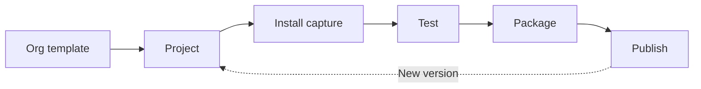

# How win32-toolkit works

You bring your own installer, or an app from [winget](glossary.md#winget), the Windows Package Manager.
win32-toolkit makes a tested Intune Win32 app from it and helps you keep it up to date.

## The journey in one picture

This is the path from an installer to an app in Intune.



First, you [install the toolkit](install.md) once. Then:

1. Org template: [create your org template](org-templates.md) once for each company you package for.
2. Project: [package an app from winget](packaging.md), and the toolkit creates a project for that app version.
3. Install capture: the toolkit [installs the app in a clean test machine](packaging.md#the-install-capture) and
   records what changed.
4. Test: [test the package](testing.md) to check that it installs, that Intune can detect it, and that it uninstalls.
5. Package: [build the package](build-intunewin.md), the `.intunewin` file that Intune accepts.
6. Publish: [connect to Intune](intune-connection.md), then [publish the app](publishing.md).

The dashed arrow is the next version of the app. To [ship a new version](new-version.md), you package it as a new
project. For an app that winget does not have, see [Package an app that is not in winget](manual-apps.md).

The next section explains each word in the picture.

## The things you work with

In the paths below, `<base folder>` is your [base folder](glossary.md#base-folder). It is the one
folder on your PC where the toolkit keeps all its files.

| Thing | What it is | Where it lives |
|---|---|---|
| [Org template](glossary.md#org-template) | Your saved settings for one customer: company name, dialogs, logo and Intune defaults. | `<base folder>\Templates\<name>.json` |
| [Project](glossary.md#project) | The folder of one app version: installer, settings and results. | `<base folder>\Projects\<template>\<project>` |
| [Install capture](glossary.md#install-capture) | An install of the app in a clean Windows that records what changed. | The `Documentation\` folder of the project |
| [Test machine](glossary.md#test-machine) | The clean Windows where captures and tests run. | Your PC: a temporary Windows, or a virtual machine (VM) that you build once |
| [Package](glossary.md#package) | The `.intunewin` file that you upload to Intune. | `<base folder>\IntuneWin\<template>\<project>.intunewin` |
| [Intune app](glossary.md#win32-app) | The Win32 app that publishing creates in Intune. | Your Intune tenant |

## The menu and the commands

The [menu](glossary.md#menu) is the normal way to work: a screen of choices inside the PowerShell
window. You start it with [`Show-Win32Toolkit`](reference/Show-Win32Toolkit.md), then move with the arrow keys and
<kbd>Enter</kbd>. See [The menu at a glance](menu.md).

The 17 [commands](reference/README.md) do the same work for scripts. A project that you make in the menu also works
with the commands, and a project from the commands also works in the menu. A few tasks are
[only in the menu or only with commands](menu.md#only-in-the-menu-or-only-with-commands). To start, see
[Use the commands in scripts](automation.md).

The toolkit runs in [PowerShell 7](glossary.md#powershell-7-and-windows-powershell-51) on your PC. The
package runs on devices, in the older Windows PowerShell 5.1. On a device, Intune starts the package with
`Invoke-AppDeployToolkit.exe`, which always uses the 64-bit Windows PowerShell.

The package runs as the [SYSTEM account](glossary.md#system-account), the Windows account that Intune
uses to install apps. See
[Why the install command is Invoke-AppDeployToolkit.exe](publishing.md#why-the-install-command-is-invoke-appdeploytoolkitexe).

## What happens when you package an app

Every package uses [PSAppDeployToolkit (PSADT)](glossary.md#psadt). PSADT is a free PowerShell tool
that installs apps on company devices in a standard way. When you package an app from winget, the toolkit does this:

1. It creates a project for the app version, with its own copy of PSADT.
2. It downloads the installer with winget into the project.
3. It writes the install settings and applies your org template: company name, dialog settings and Intune defaults.
4. It runs the install capture: it installs the app in a test machine and records what changed.
5. From the capture, it writes the uninstall for EXE installers and the list of programs to close.
6. If you choose them, it then tests, builds and publishes the package.

The install capture always runs. You cannot skip it. MSI and MSIX installers do not need it for the uninstall, but it
still finds their programs to close.

To find out if the app is installed, Intune checks a registry value that the package writes during the install. See
[How Intune detects the app](publishing.md#how-intune-detects-the-app).

## Windows Sandbox or the Hyper-V test VM

The install capture and the tests run in one of two test machines. [Windows Sandbox](glossary.md#windows-sandbox) is a temporary copy of Windows that forgets everything when it closes. The
[Hyper-V test VM](glossary.md#hyper-v-test-vm) is a virtual machine that you build once on your PC.

| Question | Windows Sandbox | Hyper-V test VM |
|---|---|---|
| What you set up | Turn on the Windows feature once, then restart. | Turn on Hyper-V, then build the test VM: about 30 to 60 minutes, plus Windows Update time. |
| Admin rights for a capture or test | Not needed | Needed: start PowerShell as administrator |
| Which Windows | A fresh copy of your PC's Windows | Your own Windows 11, kept up to date by you |
| Runs the package as | The Windows Sandbox user | SYSTEM, as Intune does |
| One [unattended test](glossary.md#unattended-test) of install and uninstall, without pauses | about 2 minutes | about 4 to 5 minutes (depends on your PC) |
| Rules that remove another install of the app | Cannot propose or prove them | Needed to propose and prove such rules |

Windows Sandbox is the default and needs no set-up beyond the Windows feature. Both start clean for every run: the
test VM goes back to a saved clean state before and after each test.

The package runs as a different account in each, so a result can differ between the two. If the test VM is your
default but is not ready, the toolkit warns and uses Windows Sandbox. In the menu, you choose the test machine for
each test.

Building the test VM does not make it your default. To set it up, see [Set up the Hyper-V test VM](hyperv-vm.md) and
[Make the test VM your default](hyperv-vm.md#make-the-test-vm-your-default).

## Where your files go

All files live in one folder on your PC, the base folder. You choose it the first time you start the toolkit, and the
toolkit saves your choice. The default is `C:\Win32Apps`.

```text
<base folder>\
  Templates\                       your org templates
  Projects\<template>\<project>\   one project for each app version
  Staging\<template>\<project>\    a cleaned copy, made when you build the package
  IntuneWin\<template>\            the finished packages
  Cache\winget\                    installers that tests use again: older versions, dependencies
  HyperV\                          only with the Hyper-V test VM
```

The project name is the app name, the architecture and the version. For example, the Git project of the Contoso org
template is `C:\Win32Apps\Projects\Contoso\Git_x64_2.53.0`.

Three rules:

1. Each org template has its own folders, so you can package the same app for several customers side by side.
2. The project is your working copy. It keeps the installer, the settings and the results of captures and tests.
3. Building a package never changes the project. The toolkit cleans only the copy in `Staging\`.

Captures, tests and publishing do write into the project. So do the commands that change its settings, such as its
dependencies. For every folder, see [The base folder layout](settings.md#the-base-folder-layout).

## How long it takes and what it costs

These times are estimates. They depend on the app, your PC and your network.

| Activity | Time |
|---|---|
| Install the toolkit | about 15 minutes, plus one restart |
| Create your org template | about 2 to 5 minutes |
| Your input in a packaging wizard | 2 to 5 minutes |
| Install capture | usually 5 to 20 minutes; the toolkit stops waiting after 30 minutes |
| Unattended install and uninstall test, Windows Sandbox | about 2 minutes |
| [Interactive test](glossary.md#interactive-test), a test that you watch | adds a 2-minute pause |
| Build the package | seconds to a few minutes |
| Publish | usually a few minutes; longer for big packages |

Your first app takes about 1 to 1.5 hours, much of it waiting. That includes the install of the toolkit and one
restart. After that, a new app needs about 5 minutes of your time and 10 to 30 minutes of waiting.

What you need:

- A PC with Windows 10 or 11 Pro, Enterprise or Education.
- PowerShell 7.4 or later. [Install the toolkit](install.md) shows how to get it.
- Internet access, and winget for apps from winget.
- Disk space: a few GB without the test VM, and about 60 to 80 GB more with it.
- Admin rights, but only to turn on Windows features, to install PowerShell 7 and for the test VM.
- Intune and its licenses. They come from Microsoft, not from the toolkit.

win32-toolkit itself is free and open source, under the MIT license.

## What the toolkit never does

- win32-toolkit never assigns an app. You assign it in the Intune admin center.
- Every publish creates a new app in Intune. Publishing again does not change the old app. The toolkit also never
  deletes an app and never sets [supersedence](glossary.md#supersedence), the Intune setting that
  replaces an old app with a new one.
- win32-toolkit never turns on Windows features. You turn them on once.
- A failed test only warns. It does not stop packaging or publishing.
- The toolkit never removes another install of the app from devices on its own. Only an [Enforce](glossary.md#enforce) rule does that, and only you can add one. Before it builds such a package, the toolkit
  asks you to prove the rule on the test VM.
- The toolkit always packages the newest version that winget offers. For an older version,
  [package the installer yourself](manual-apps.md).

One command changes an app that is already in Intune:
[`Sync-Win32ToolkitAppDependency`](reference/Sync-Win32ToolkitAppDependency.md). It changes only the app's
dependencies.

## About the examples in this guide

The guide uses the same sample values on every page. Replace them with your own values.

| Item | Sample value |
|---|---|
| Base folder | `C:\Win32Apps` (the default) |
| Org template | `Contoso` |
| Tenant ID | `11111111-2222-3333-4444-555555555555` |
| Account | `admin@contoso.onmicrosoft.com` |
| App from winget | `Git.Git` (Git for Windows) `2.53.0`, x64, project `Git_x64_2.53.0` |
| Older version for update tests | `2.52.0` |
| App with two installer technologies | `Notepad++.Notepad++` |
| App that another app needs first | `winget:Microsoft.VCRedist.2015+.x64` |
| App that is not in winget | Contoso Reader `3.2.0`, an MSI from `Contoso Ltd`, project `Contoso_Reader_x64_3.2.0` |
| Second app that is not in winget | Fabrikam CAD `12.0`, an EXE from `Fabrikam` |
| Hyper-V test VM | VM `win32tk-golden`, user `w32admin`, Windows ISO file `C:\ISO\Win11_x64.iso` |

Your version of Git will differ, because winget always offers the newest one.

## Next step

Install the toolkit and turn on Windows Sandbox.

[Next: install the toolkit](install.md){ .md-button .md-button--primary }
