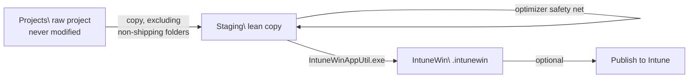

# Packaging a project into a `.intunewin`

[Export-Win32ToolkitIntuneWin](reference/Export-Win32ToolkitIntuneWin.md) compiles a finished PSADT project into the `.intunewin` file that Intune's Win32 app model requires. It never touches your raw project: everything happens on a disposable **Staging** copy, and the output lands in its own **IntuneWin** tier.

To package a project:

```powershell
# Interactive: pick a project from a numbered list
Export-Win32ToolkitIntuneWin

# Direct: point at the raw project folder
Export-Win32ToolkitIntuneWin -ProjectPath 'C:\Win32Apps\Projects\Contoso\Git_x64_2.53.0'
```

If you started from [Invoke-Win32Toolkit](reference/Invoke-Win32Toolkit.md) with `-PackageIntune`, this step runs automatically at the end of the pipeline.

## What happens, step by step



1. **Resolve the project.** Without `-ProjectPath`, a numbered picker scans `BasePath\Projects\`. With `-ProjectPath` but no `-BasePath`, the base folder is derived from the path. The project must sit in the `<BasePath>\Projects\<Template>\<ProjectName>` layout, otherwise the command stops and asks you to pass `-BasePath` explicitly rather than creating `Staging\` and `IntuneWin\` somewhere unexpected. Then the deploy script must pass [the package check](#the-package-check), before anything is downloaded or copied.
2. **Get the packaging tool.** See [IntuneWinAppUtil.exe](#intunewinapputilexe-auto-download-and-verification) below.
3. **Copy the project to Staging.** Only shipping content is copied (see the next section).
4. **Run the optimizer** on the Staging copy as a safety net.
5. **Build the package** with `IntuneWinAppUtil.exe` and rename the output to `<ProjectName>.intunewin`.
6. **Offer to publish** (see [Publishing straight after packaging](#publishing-straight-after-packaging)).

## The package check

win32-toolkit refuses to package a deploy script it cannot vouch for. Every problem is collected and reported at once, each with its fix, in one `W32T.PackageNotReady` error; nothing is packaged or published.

| Check | Result when it fails |
|---|---|
| `Invoke-AppDeployToolkit.ps1` exists and parses | error |
| It also parses under Windows PowerShell 5.1, which Intune uses to run it | error |
| `Invoke-AppDeployToolkit.exe` (the launcher Intune starts) sits next to it | error |
| It carries the toolkit's AppConfig loader (it was generated by win32-toolkit) | error |
| Its PSAppDeployToolkit template layout and version are supported (PSADT 4.1.x or 4.2.x) and match the PSADT module bundled in the project | error, starting with `Unsupported PSADT template shape:` |
| The uninstall cleanup paths stay inside the app's own install folders (the uninstall deletes them as SYSTEM) | error, no override, starting with `Unsafe uninstall cleanup path:`. A `SupportFiles\AppConfig.json` that cannot be read is an error too: Windows PowerShell 5.1 on the device may still read it and delete paths nobody checked |
| It writes the install tattoo | warning: detection falls back to the install capture |
| It was generated by win32-toolkit 1.1.6 or older | warning: still packaged as-is (its uninstall does not remove the legacy `WOW6432Node` tattoo, see [Apps published before this version](publishing.md#apps-published-before-this-version)) |
| The PSAppDeployToolkit bundled in the project is a prerelease (for example `4.2.0-rc2`) | warning: still packaged; rebuild on a stable PSAppDeployToolkit before production. Publishing warns again |

The same check (without the 5.1 parse, launcher, bundled-module and prerelease rows, and the uninstall cleanup-path row) also runs before a project is captured and tested by `Invoke-Win32Toolkit`, `New-Win32ToolkitManualApp` and `Complete-Win32ToolkitManualApp`. To package a hand-maintained deploy script that win32-toolkit never generated, pass `-AllowLegacyScript` to `Export-Win32ToolkitIntuneWin` (or `Complete-Win32ToolkitManualApp`): the loader, layout and bundled-module findings then become warnings. Parse errors, a missing launcher and an unsafe uninstall cleanup path still stop the export.

## Installer technology

Many apps on winget ship more than one installer for the same version: Notepad++, for example, offers a vendor EXE (NSIS) and an MSI. The two register differently in Windows (different uninstall entries, different product codes), so a device that already has one and then receives the other ends up with **two registrations over one folder**. Pick one technology per app and keep it from version to version.

**Families.** win32-toolkit groups winget installer types into families that register the same way:

| Family | winget installer types |
|---|---|
| MSIX | `msix`, `appx` (and `msstore`, which cannot be packaged) |
| MSI | `msi`, `wix` |
| EXE | `burn`, `nullsoft`, `inno`, `exe` |

When you do not pin a technology, winget picks one by its own order of preference (winget 1.29.280 and later: `msstore`, `msix`, `msi`, `wix`, `burn`, `nullsoft`, `inno`, `exe`, `portable`). That is why winget may hand you the MSI of an app you used to package as an EXE.

**Pinning the technology.** Pass `-InstallerType` to [Invoke-Win32Toolkit](reference/Invoke-Win32Toolkit.md):

```powershell
# Package the vendor EXE (NSIS) instead of winget's default MSI
Invoke-Win32Toolkit -Id 'Notepad++.Notepad++' -Architecture x64 -Force -InstallerType nullsoft
```

The pin covers the whole family: if the version you package does not offer that exact type, win32-toolkit tries the other types of the same family in order (for example `wix`, then `msi`) and warns which one it used. For each type that is not offered, winget prints `No applicable installer found; see logs for more details.` and the next line names the type win32-toolkit tries next. It never falls back to another family.

**Continuity.** Without `-InstallerType`, win32-toolkit looks for an earlier version of the same winget id in the same template folder that was **published** (to the template's tenant when the template has one) or **pinned** with `-InstallerType`, and keeps that version's technology. An earlier version that was only built, never published or pinned, does not count. The run prints the decision before the download, for example `Installer technology: nullsoft (kept from Notepad++_x64_8.8.9 (published))`, or `Installer technology: winget's choice`.

**Rebuilding a version.** Re-creating a version that is itself published or pinned (running it again with `-Force`) keeps that version's own technology, ahead of any earlier version: `Installer technology: wix (kept from Notepad++_x64_8.9.8.1 (published, rebuilt))`. The project's `Intune\Publications.json` is kept across the re-creation, so the rebuilt version still anchors later versions; if it cannot be kept (the command warns), republish the rebuilt version. Passing `-InstallerType` of another family still wins, with a warning that devices which already have the version get a second registration.

**In the menu.** When you package an app from the menu (`Show-Win32Toolkit`), the wizard checks which technologies winget ships for the version and asks once when there is more than one you can package. With a published or pinned earlier version it offers `Keep <technology> (recommended)` first; when you rebuild a version that is itself published or pinned, that version is the one kept (`recommended: <project> is published; rebuilding it`). If the version no longer ships the earlier version's technology, the wizard says so before the build and asks once: skip this version (recommended, nothing is built), switch to a technology the version ships (devices that already have the earlier one get a second registration), or keep it anyway (the build then stops with `W32T.InstallerVariantUnavailable`). Technologies win32-toolkit cannot package (zip-wrapped installers, Microsoft Store only) are listed but cannot be chosen.

**What is recorded.** The project's `SupportFiles\AppConfig.json` gets a `Source` section: the winget id and version, the installer type and family that were packaged, the scope, architecture and locale from the winget manifest, the winget client version, how the technology was chosen (`PinnedBy`: `parameter`, `continuity` or `winget-default`) and, for an MSI, its ProductCode and UpgradeCode. It is data only (the deploy script does not read it) and holds no tenant id or user name.

**When the pinned technology is not offered.** If winget has no installer of the pinned family for the version (for example a vendor dropped its MSI for one release), the command stops with a `W32T.InstallerVariantUnavailable` error and nothing is downloaded. The message lists the types that were tried. You have two options:

1. Skip this version and package the next one that ships the technology again. This is the recommended choice when a vendor drops a technology for one release.
2. Switch technology on purpose with `-InstallerType <other type>`. Devices that already have the earlier technology then get a second registration.

**Identity checks after the download.** Once the installer is downloaded, win32-toolkit compares it with what winget ships and with the earlier versions in the template folder, prints warnings, and stores the result in `Documentation\IdentityDelta.json` (it never ships). None of them blocks packaging:

| Code | Meaning | What to do |
|---|---|---|
| `ID-SIBLING-FAMILY` | winget also ships another technology you could package for this version | Keep one technology across your devices; to package the other one, use the `-InstallerType` the message names. To test the switch, run `Test-Win32ToolkitProject -Scenario Update -BaselineInstallerType Both` |
| `ID-SIBLING-UNTESTABLE` (info) | winget also ships a technology win32-toolkit cannot package or test (zip-wrapped, Microsoft Store only) | Nothing to do |
| `ID-NO-ANCHOR` | winget chose the technology, the app ships more than one, and no earlier version in this template was published or pinned | Pin it with `-InstallerType` (or choose it in the menu) so later versions keep it |
| `ID-PROBE-UNAVAILABLE` | The list of technologies could not be read from the winget repository (offline, proxy, rate limit) | If the app ships both an EXE and an MSI, pin one with `-InstallerType` |
| `ID-FAMILY` | The technology changed compared with the published or pinned earlier version | Rebuild with the `-InstallerType` the message names to keep the earlier technology |
| `ID-TATTOO` | The detection key (template author, vendor, display name) changed compared with the earlier version | Devices with the earlier version keep it detected under the old key; check the template and app names |
| `ID-SCOPE` | The winget manifest labels the installer user-scope | Intune installs as SYSTEM; check the install capture in `Documentation\InstallationChanges_*.json` |
| `ID-PREDECESSOR-AMBIGUOUS` | Several winget ids in the template look like the same product | Check that the named earlier version is the right one |
| `ID-VARIANT-SUBSTITUTE` (info) | The version did not offer the exact pinned type; another type of the same family was packaged | Nothing to do |

**Warnings shown again at Export and Publish.** Packaging the project (`Export-Win32ToolkitIntuneWin`) and publishing it (`Publish-Win32ToolkitIntuneApp`, or **Publish to Intune** in the menu) show these identity checks again, together with what the project's [Update tests](testing.md#which-installer-technology-the-old-version-uses) found: `UPDATE-FAILED` (the latest Update test from a technology failed), `ID-TECH-SWITCH` (an Update test saw the other technology's install stay registered after this package installed), `ID-SIBLING-UNTESTED` (winget ships another technology you could package, and no Update test from it has passed yet), `ID-SIBLING-UNTESTABLE` (information only, shown in the menu and with `-Verbose`: the other technology cannot be packaged or tested) and, when publishing, `UNSAFE-CLEANUP` (the project's uninstall cleanup paths fail [the package check](#the-package-check), so a package exported before that check deletes folders outside the app's own install folder). They only warn, once per action, and never stop a package or a publish. What each one means and what to do: [Warnings before you publish](publishing.md#warnings-before-you-publish).

win32-toolkit does not yet remove the other technology from a device before installing. Until it can, keep one technology per app across your devices, and run the [Update test](testing.md#choosing-the-old-version-baseline) from the technology your devices already have.

## The Staging copy: what ships and what never does

The raw project under `Projects\` is your source of truth and is **never modified during packaging**. Each run copies it fresh into `Staging\<Template>\<ProjectName>`, but the copy *excludes* the non-shipping folders up front, so they never exist in Staging at all:

| Excluded folder | Why it must not ship |
|---|---|
| `Sandbox\` | Test scaffolding: `.wsb` configs, countdown scripts, the old-version installer, dependency installers |
| `Documentation\` | Sandbox install-capture JSON and logs |
| `Intune\` | **Privacy:** holds `Publications.json`, your tenant id and Intune app ids. These must never travel to an end-user device |
| `Docs\`, `Examples\` | PSADT v4 boilerplate: pure package bloat |

Excluding at copy time (rather than copying everything and deleting afterwards) means the copy is smaller and faster, there is no freshly-written file for antivirus to lock mid-delete, and the tenant/app ids in `Intune\Publications.json` cannot leak into the package even if a later cleanup step were to fail.

### The optimizer safety net

After the copy, the optimizer runs on the Staging copy anyway. It is normally a no-op for the folders above, but it catches anything that slipped through and additionally removes:

- `*.md` and `*.wsb` files in the project root
- `SupportFiles\TargetedDocumentationScript*` and its log files (`SupportFiles\RequirementScript.ps1` is **kept** for reference; nothing uploads it)
- Any empty subdirectories

If a locked file prevents stripping a bloat folder, you get a warning and a slightly larger package. If the `Intune\` folder itself cannot be removed, packaging **refuses to continue**. A larger package is acceptable, leaked tenant ids are not.

## IntuneWinAppUtil.exe: auto-download and verification

The packager is Microsoft's official Win32 Content Prep Tool. On first use it is downloaded automatically into the module's `Tools\` folder (latest GitHub release first, raw repository file as fallback). No manual setup.

Because this binary is executed on your packaging machine, its **Authenticode signature is verified on every run**, both right after a download and for a copy that already sits in `Tools\`. The signature must be valid and issued to *Microsoft Corporation*; anything else is deleted on the spot so a rejected binary can never be silently reused. If the download fails, the error tells you where to fetch the tool manually and where to place it.

## Where the output lands

Output is grouped by [org template](org-templates.md), like every other tier:

```
C:\Win32Apps\
  Projects\
    Contoso\
      Git_x64_2.53.0\            raw project (Sandbox\, Documentation\, Intune\ intact)
  Staging\
    Contoso\
      Git_x64_2.53.0\            lean copy, kept after the run
  IntuneWin\
    Contoso\
      Git_x64_2.53.0.intunewin   ready to upload
```

## Re-packaging

Running the command again on the same project is always safe:

- The previous Staging copy is deleted (with retries for briefly AV-locked files) and rebuilt from the current raw project, so Staging always reflects your latest edits. If a file stays locked, the run fails loudly rather than packaging a stale, half-cleared copy.
- An existing `<ProjectName>.intunewin` is overwritten.

So the edit loop is simply: change the project under `Projects\`, re-run `Export-Win32ToolkitIntuneWin`.

## Publishing straight after packaging

When the package is built and neither `-PublishIntune` nor `-PublishUpdate` was passed, you are asked interactively: `Upload to Microsoft Intune now? (Y/N)`. Answer `Y` to hand off to [Publish-Win32ToolkitIntuneApp](reference/Publish-Win32ToolkitIntuneApp.md) immediately.

To skip the question:

```powershell
# Package and publish in one step (prompts for Graph sign-in on first use)
Export-Win32ToolkitIntuneWin -ProjectPath $proj -PublishIntune

# Also publish the requirement-gated update app alongside the install app
Export-Win32ToolkitIntuneWin -ProjectPath $proj -PublishIntune -PublishUpdate
```

Automation can suppress the prompt entirely with `-NoPublishPrompt`. See the [Publish-Win32ToolkitIntuneApp](reference/Publish-Win32ToolkitIntuneApp.md) reference for what publishing does, including the update-app behavior and upload timeouts.
