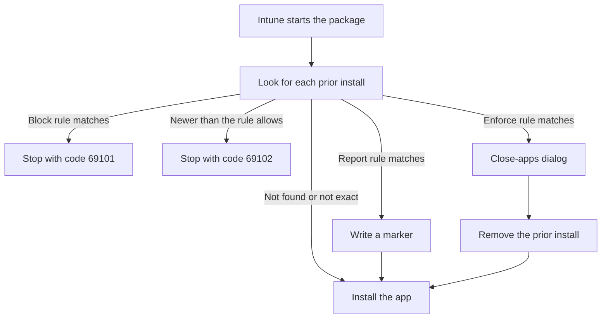

# Prior installs on devices

Some devices already have your app, but installed with another [installer technology](glossary.md#installer-technology): another kind of setup program. For example, your package installs the
Notepad++ MSI, and some devices have the vendor's NSIS setup. Such an install is a [prior install](glossary.md#prior-install).

A [prior-install rule](glossary.md#prior-install-rule) names that install exactly and tells your package
what to do. This page shows what devices do with these rules and how to act in an incident. To create rules, see
[Devices that already have the app](prior-installs.md).

## What happens on a device

Every rule has one of three modes:

- [Block](glossary.md#block): the install fails on a device that has the prior install.
- [Enforce](glossary.md#enforce): the package removes the prior install with its own uninstaller, then
  installs your app.
- [Report](glossary.md#report): the package writes a marker in the registry and installs your app.

Only Enforce removes anything. The package checks every rule before it installs:



The package works in this order:

1. It looks for each prior install. It removes nothing and shows no dialog yet.
2. It shows the close-apps dialog of your [org template](glossary.md#org-template). The old app is one of the apps it
   closes.
3. It runs the `PreInstall.ps1` [hook script](glossary.md#hook-script) of your org template, if there is one.
4. It removes the prior install of each Enforce rule, and checks that it is gone.

Most refusals stop the deployment in step 1, before any app is closed. Every refusal stops it before your app installs.
If an install has another publisher, another name or a version older than the rule covers, the package leaves it as it
is. Your app then installs.

### What people on the device see

- **Block**: no dialog. The install fails.
- **Enforce**: the close-apps dialog asks people to close the old app if it is open. Then the old app is removed
  silently, and your app installs.
- **The old app is still open after the dialog**: the package stops with code 1618. Intune tries again later.

## Roll out safely

Enforce removes another install as SYSTEM. Assign the package to a pilot group first. The [SYSTEM account](glossary.md#system-account) is the Windows account with full rights that Intune uses for installs.

A [pilot group](glossary.md#pilot-group) is a small group of devices that gets the app first. A Block
rule needs a pilot group too: every device with the prior install fails with code 69101.

Before a wider assignment, check these points.

- **Turn off the app's own updater.** The Notepad++ updater installs the NSIS setup again: devices fail with 69110 or
  69102. The vendor documents how to turn it off.
- **Unassign Required apps that detect the old install.** They install it again, and devices fail with code 69110. For
  Enforce rules, publishing warns about these apps after you sign in.
- **Keep the welcome dialog on.** It closes the old app before the removal. Without it, devices where the old app is
  open fail with code 1618 again and again. In the org template wizard, answer `y` at **Show Welcome dialog on
  install** (the default).
- **Keep the maximum run time at 60 minutes or more.** The [maximum run time](glossary.md#maximum-run-time) is how long Intune lets the install run. One uninstaller alone can take up
  to 30 minutes. In the org template wizard, it is **Max run time (minutes)**, and the default is 60.

Changes to an org template reach new projects only. Re-create a project to apply them. Then
[prove its Enforce rules again](prior-installs.md#next-versions-and-re-created-projects).

You can also change the maximum run time in the Intune admin center, at **Installation time required (mins)**.

win32-toolkit never assigns an app. You assign it in the Intune admin center.

## Read what devices report

A device reports what happened in three places.

### Exit codes

Every run ends with an [exit code](glossary.md#exit-code): a number that tells Intune if the install
worked. You will see these four most often:

| Code | What it means | What to do |
|---|---|---|
| 69101 | A Block rule found the prior install. Nothing was removed or installed. | Keep blocking, or change the rule to Enforce and [prove it](prior-installs-enforce.md#prove-the-rule). |
| 69110 | The prior install came back after this package removed it. | See [Clear a 69110](#clear-a-69110). |
| 69111 | The [kill switch](#stop-all-removals-with-the-kill-switch) is on. Nothing was removed or installed. | Nothing. This is expected during an incident. |
| 1618 | The old app was still open, or Windows Installer was busy. | Nothing. Intune tries again later. |

The toolkit adds these codes to every app it publishes, even an app without rules. Intune shows them as failed, except
1618, which Intune retries. For every code, see [Prior-install codes](exit-codes.md#prior-install-codes).

### Markers in the registry

The package writes markers under `HKLM\SOFTWARE\<app script author>\win32-toolkit`. The [app script author](glossary.md#app-script-author) is the name you typed at **App script author** in the org template wizard.
The default is `IT Packaging Team`.

| Value | What it tells you |
|---|---|
| `LastRefusal` | The date, exit code and package version of the last refusal. |
| `PriorInstalls\<view>\<key>\LastSeen` | The package saw this install and left it, or planned its removal. |
| `PriorInstalls\<view>\<key>\Removed` | The date the package removed this install. `Version` holds the removed version. |
| `RemovePriorDisabled` | The kill switch. You set it. The package only reads it. |

Read these values with a 64-bit script. A 32-bit script looks under `WOW6432Node` and does not see them. In an Intune
remediation, set **Run script in 64-bit PowerShell** to **Yes**.

### The PSADT log

The package logs every decision in the log of [PSAppDeployToolkit (PSADT)](glossary.md#psadt), the
install engine inside every package. Search the log for `win32-toolkit prior-check` and `win32-toolkit remove-prior`.
A refusal line ends with its exit code.

```text title="A Block refusal in the PSADT log"
win32-toolkit prior-check: [nsis-x64] a prior install is present (...) and its policy is Block; nothing removed, nothing installed (exit code 69101)
```

!!! note "The log looks worse than it is"
    PSADT logs every refusal as an error that starts with `An unhandled error within`, with a stack trace. That is
    expected. A line that ends with `it is removed after the close-apps dialog` is only the plan. A later line can still
    show a refusal.

To find the log files, see [Where to find logs](exit-codes.md#where-to-find-logs).

## Stop all removals with the kill switch

The [kill switch](glossary.md#kill-switch) is a registry value that stops every removal on a device. Set
the DWORD `RemovePriorDisabled` to `1` under `HKLM\SOFTWARE\<app script author>\win32-toolkit`. Use a 64-bit
remediation script, for example:

```powershell
$key = 'HKLM:\SOFTWARE\IT Packaging Team\win32-toolkit'   # use your app script author
if (-not (Test-Path -LiteralPath $key)) { New-Item -Path $key -Force | Out-Null }
New-ItemProperty -LiteralPath $key -Name 'RemovePriorDisabled' -Value 1 -PropertyType DWord -Force | Out-Null
```

What the kill switch does:

- A device that would remove a prior install refuses with code 69111. Nothing is removed or installed.
- It stops removals for every app with this app script author.
- Other devices, and Block and Report rules, work as before.
- The package reads the switch again right before the removal. Only the value `1` counts.

The package reads both [registry views](glossary.md#registry-view). On 64-bit Windows, the registry has
one view for 64-bit apps and one for 32-bit apps (`WOW6432Node`). A 32-bit script also works, but prefer 64-bit.

### Turn removal on again

Delete `RemovePriorDisabled` in both registry views. A value of `1` in either view keeps removal off.

```powershell
$author = 'IT Packaging Team'   # use your app script author
foreach ($key in "HKLM:\SOFTWARE\$author\win32-toolkit", "HKLM:\SOFTWARE\WOW6432Node\$author\win32-toolkit") {
    Remove-ItemProperty -LiteralPath $key -Name 'RemovePriorDisabled' -ErrorAction SilentlyContinue
}
```

## Incident runbook

Use these steps when removals go wrong on devices. Step 3 uses the log of the [Intune Management Extension](glossary.md#intune-management-extension), the Intune agent on the device.

1. In the Intune admin center, unassign the app or exclude the affected group. This is the fastest stop.
2. Where the app stays assigned, turn on the [kill switch](#stop-all-removals-with-the-kill-switch).
3. On an affected device, read `LastRefusal`, the PSADT log and the Intune Management Extension log.
4. Fix the rule in your project. See [See, change or remove rules](prior-installs.md#see-change-or-remove-rules).
5. For an Enforce rule, [prove the rule](prior-installs-enforce.md#prove-the-rule) again.
6. Build the package again.
7. Publish the new package. Assign it to a pilot group whose devices do not have the kill switch on.
8. When the pilot works, unassign the old app everywhere.
9. Turn removal on again in both registry views. Then assign the new app more widely.

Every publish creates a new app in Intune. Publishing again does not change the old app.

## Clear a 69110

Code 69110 means that a prior install came back after the package removed it. The package does not remove it a second
time. To clear it:

1. Find what installs it again. Usually it is the vendor's updater or a Required app.
2. Stop that cause.
3. Delete the `Removed` value of that prior install with a 64-bit remediation script.

The value is under `HKLM\SOFTWARE\<app script author>\win32-toolkit\PriorInstalls\<view>\<key>`. The view is `Native`
for 64-bit installs or `Wow6432` for 32-bit installs. The key is the name of the uninstall key, for example `Notepad++`.

```powershell
$key = 'HKLM:\SOFTWARE\IT Packaging Team\win32-toolkit\PriorInstalls\Native\Notepad++'   # your author, view and key
Remove-ItemProperty -LiteralPath $key -Name 'Removed' -ErrorAction SilentlyContinue
```

!!! warning "Fix the cause first"
    If you delete `Removed` too early, the package removes the old app again. Then the cause installs it again, and the
    device fails with 69110 once more.

The Notepad++ updater can install the NSIS setup over your MSI install. Clearing `Removed` then gives code 69106 for the
same package version (your app is registered next to the prior install). Remove the NSIS install in **Settings** >
**Apps**, then repair or reinstall your app. Or wait for your next package version.

## Next steps

- [Exit codes and logs](exit-codes.md): every code, and where to find the logs.
- [Remove a prior install (Enforce rules)](prior-installs-enforce.md): approve, prove and ship an Enforce rule.
- [Troubleshooting](troubleshooting.md#symptoms-in-intune-or-on-devices): symptoms in Intune or on devices.
