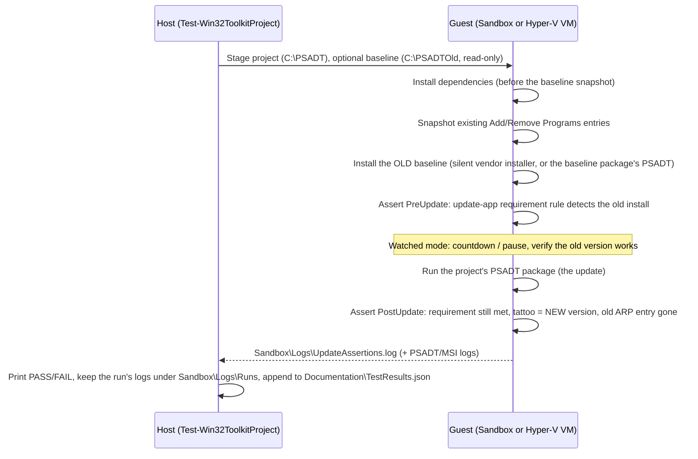

# Testing packages

Before a package ever reaches a device, you can prove it installs, uninstalls, and updates cleanly, in a
disposable Windows guest, with real pass/fail assertions. The command that does this is
[Test-Win32ToolkitProject](reference/Test-Win32ToolkitProject.md); it can run standalone against any
existing project, or be chained onto a packaging run with `Invoke-Win32Toolkit -RunTest`.

Every test run ends with a recorded **PASS / FAIL / inconclusive** verdict in the project's
`Documentation\TestResults.json`, the same history the generated customer documentation reports.

## Test backends: Windows Sandbox vs Hyper-V VM

Tests run in one of two guest environments:

| | **Windows Sandbox** (default) | **Hyper-V test VM** (opt-in) |
|---|---|---|
| Setup needed | None (Windows feature) | One-time VM build (see [Hyper-V test VM](hyperv-vm.md)) |
| Guest lifetime | Disposable: a fresh guest cold-boots for every run | Persistent VM, reverted to a warm checkpoint per run (no cold boot; each run restores the checkpoint twice, which costs seconds to about a minute each depending on the host) |
| Concurrency | One sandbox at a time (the toolkit waits up to 90 s for a previous one to close) | No single-instance limit from Sandbox |
| Unattended runs execute as | The sandbox's built-in admin user, `-DeployMode Silent` | **SYSTEM**, with the published Intune command line from a 32-bit parent (Intune parity) |

To make Hyper-V the default backend, set the `TestBackend` config value (stored in the toolkit's
per-user registry key):

```powershell
Set-ItemProperty -Path 'HKCU:\Software\CloudFlow\win32-toolkit' -Name TestBackend -Value 'HyperV'
```

You can also pick a backend for a single run with the `-Backend` parameter. Either way, if Hyper-V is
selected but not ready (not elevated, VM or checkpoint missing, no guest credential saved), the run
**falls back to Windows Sandbox with a warning** instead of failing. Documentation capture follows the
same backend choice.

## Watched vs unattended

Both backends run **watched** (interactive) by default: you get a verification window (a 2-minute
countdown dialog in the Sandbox, or a host-side pause on Hyper-V) to click around in the freshly
installed app before the test continues. In the Sandbox the guest window stays open afterwards for
manual inspection. Which PSADT dialogs you see differs per backend:

- **Sandbox** runs the package in PSADT's **Auto** mode, like Intune does. On PSADT 4.2 the dialogs
  appear only when one of the app's processes-to-close is running; otherwise the run is silent. On
  4.1 an app with an empty processes-to-close list still shows them. (See
  [when dialogs appear](org-templates.md#when-dialogs-appear).)
- **Hyper-V** watched runs force `-DeployMode Interactive`, so the dialogs always show.

Pass `-Unattended` for back-to-back automation:

- No countdown, no pauses.
- **Sandbox**: PSADT runs with `-DeployMode Silent`, and the guest **shuts itself down** after
  collecting logs, so a chained run (for example `-RunTest InstallUninstall, Update`) proceeds without
  anyone closing windows.
- **Hyper-V**: the install, the uninstall and the update run as an **Intune-parity** phase: the exact
  published command line (`Invoke-AppDeployToolkit.exe -DeploymentType Install` or `Uninstall`, no
  deploy mode) started from a 32-bit `cmd.exe`, as SYSTEM, in the package folder, the way the Intune
  Management Extension starts it. Its exit code is checked against Intune's success codes (0, 1707,
  3010, 1641).

To make unattended the default per backend, set the `SandboxTestMode` and/or `HyperVTestMode` config
value to `Unattended` in the same registry key. An explicit `-Unattended` switch always overrides the
config. `-TestMode Interactive` runs one test watched although the config value says `Unattended`;
`-TestMode Unattended` is the same as `-Unattended`. On a **non-interactive host** (CI pipeline,
redirected stdin), the toolkit auto-selects Unattended and prints a loud warning, also over
`-TestMode Interactive`. Interactive mode would block forever on prompts nobody can see.
In the menu, **Run a test** asks the Hyper-V run mode and passes it as `-TestMode`; the mode `HyperVTestMode`
sets is the first choice, so pressing Enter keeps it. A Sandbox test follows `SandboxTestMode`. The screen
shows the mode before the run starts, and the packaging wizards' Review panel shows it when you tick the test.

> **Context caveat.** A Sandbox-unattended run executes as the sandbox's interactive admin user, while a
> HyperV-unattended run executes as **SYSTEM, with the same launcher, bitness and command line Intune
> uses on a real device**. The two verdicts are therefore *not equivalent evidence*: an app that behaves
> differently under SYSTEM (per-user shortcuts, HKCU writes, user profile paths) can pass in the Sandbox
> and still fail via Intune. The recorded outcome includes the backend and mode so you can tell them
> apart later. For the closest-to-Intune signal, use the Hyper-V backend unattended.

**PSADT 4.1 dialogs in an unattended Hyper-V run.** The toolkit's test VM always restores to a signed-in
desktop: its checkpoint is taken at an AutoLogon desktop. PSADT's Auto mode shows its dialogs to a
signed-in user, and PSADT 4.1 shows its welcome dialog whenever the user may defer, even when the app has
no processes to close. So before an unattended Hyper-V test of a PSADT 4.1 package with **no processes to
close** and a **welcome dialog that lets the user defer** (the org template's welcome with `AllowDefer`,
or a deferrable welcome in the deploy script), the toolkit checks the VM over PowerShell Direct. When a
user is signed in, which the toolkit's VM always is, the test is **not started**: nobody would answer the
dialog, so the run would wait 25 minutes and then fail with exit code 1460. A warning says so before
anything runs (nothing is written, cleared or downloaded for the test: the logs of the previous run stay
in place), and the test is recorded as Inconclusive with the reason (the customer documentation shows it
as "Not run (Intune-parity pre-check)"). To test such a package:

- run the test **watched** and answer the dialog in the VM window:
  `Test-Win32ToolkitProject ... -Backend HyperV -TestMode Interactive` (it overrides `HyperVTestMode` for that
  run, see [Configuration](configuration.md#test-modes-sandboxtestmode-hypervtestmode)), or **Interactive** as
  the Hyper-V run mode under **Run a test** in the menu, from an interactive console (a host that cannot
  prompt always runs unattended); or
- list the app's process in `ProcessesToClose`, so that PSADT 4.1 asks only while the app is running
  (on devices too).

Devices with a signed-in user show the same dialog. Signing the user out of the VM is not a remedy:
watched and unattended runs restore the same checkpoint, a watched run needs the signed-in desktop (a run
that lands on the sign-in screen restarts the VM to sign in again), and changing the VM's resources or
repairing its checkpoint takes a signed-in checkpoint again. The check runs only for such packages and
can take a few minutes, with one line on the console while it runs: it restores the VM's checkpoint before
and after it looks (a test that then starts skips its own first restore). The answer is kept per checkpoint
(`HyperVPrecheckCache`, [Configuration](configuration.md#hypervprecheckcache-default-on)): later tests on the same
checkpoint skip the check and its restores. When it cannot reach the VM or read its
sessions, it warns and the test starts as usual. PSADT 4.2 packages are not checked: PSADT 4.2 resolves
Auto mode to Silent when no listed process is running.

**Exit code 1460.** The guest runner stops a package that is still running after 25 minutes (35 for the
Intune-parity uninstall, see below) and records exit code 1460. For an Intune-parity phase the warning
names the likely cause:

- **Install or update phase**: a PSADT dialog waiting for the user signed in to the VM (for example
  because a listed process to close was running, or, on PSADT 4.1, a welcome dialog), or an installer that
  did not finish. Run the test watched to see it (`-TestMode Interactive`, see above).
- **Uninstall phase**: the package was still running after 35 minutes, longer than the 30-minute limit
  the uninstall of a project created with this version puts on an EXE uninstaller: a project created
  before that limit (re-create it), or a step the limit does not cover, for example an MSI uninstall.

The PSADT log under `Sandbox\Logs` shows where the package stopped.

**Test-run limits and the device limit.** On a device, the uninstall of a project created with this
version stops an EXE uninstaller that is still running after 30 minutes and fails with exit code 69113.
The Intune-parity uninstall of an unattended Hyper-V test may run 35 minutes (40 for the whole phase), so
it ends the same way: exit code 69113 (the warning says so), and the uninstall assertions fail because the
detection tattoo stays, as on a device. The other limits stay below the device limit: 25 minutes in the
guest runner for the install, the update and the watched uninstall (30 for the Hyper-V phase around it),
and 10 minutes for the Sandbox install/uninstall wait. A hung uninstaller shows there as exit code 1460
(watched Hyper-V) or as an Inconclusive run (Sandbox).

The `Documentation\TestResults.json` record of an unattended Hyper-V run says how each Intune-parity phase
that failed ended: its `Notes` give one sentence per phase with the exit code, and say what 69113 (the
app's own uninstaller was still running at the device's 30-minute limit and was stopped) and 1460 (the
test's own limit for the phase was reached) mean. The customer documentation does not show `Notes`.

The record of a Hyper-V run also keeps `Timing` (seconds per step: opening the VM, copying the project in,
each phase that ran, the teardown, the whole run, and whether the run could skip its first checkpoint
restore) and `Lane` (the VM and its checkpoint: names, Ids, the checkpoint's age, the VM's processors and
memory, and a one-time check of the checkpoint's sign-in and Defender state). The customer documentation
does not show them.

**Checkpoint warnings.** What an unattended Hyper-V test proves depends on the checkpoint it restores. Once per
checkpoint (the answer is stored, see `HyperVCheckpointAttestation` in [Configuration](configuration.md)), an
unattended run checks in the guest that a user is signed in, that Defender real-time protection is on, that
Defender has no exclusions and how old its signatures are. A checkpoint older than 35 days, nobody signed in,
real-time protection off, an exclusion, or signatures older than 35 days (or never updated) each print one
warning, once per PowerShell session, and add one sentence to the record's `Notes`; the test still runs. Re-take
the checkpoint as [Hyper-V test VM](hyperv-vm.md) describes.

### One package, one process

Every PSADT package in a test (each `project:` dependency, an Update baseline project, and the app
itself) runs in its **own** Windows PowerShell process: PSAppDeployToolkit 4.2 refuses to load a second
copy of itself into one process, and 4.1 and 4.2 packages cannot share one. The app, the baseline and
the update are started by the guest runner `Sandbox\Invoke-PsadtPackage.ps1`, which records the exact
exit code of each run in `Sandbox\Logs\PsadtExitCodes.log`, for example:

```text
[2026-10-16 10:12:03Z] app Install parent=x86-cmd exit=0 result=Success
```

`parent=x86-cmd` marks an Intune-parity run, `parent=x64-direct` a direct run. An Update test from a vendor
installer (a winget version, not a toolkit project) records that baseline install too, as
`baseline Install parent=vendor exit=<code> result=<class>`; each declared dependency adds a `dep:<name>` line. `parent=native-cmd` means the
guest had no 32-bit `cmd.exe` (no `SysWOW64`), so no 32-bit parent ran and that run is not true Intune parity. Each test run starts its
lines with a `-- test run <name> --` line. The times in this log and in the assertion logs are UTC (the
trailing `Z`), so the guest's lines and the host's run line read in order whatever time zone the VM or
Sandbox uses; the run folder names below use the host's local time. The host prints the lines of the run that just ended, and the
Sandbox countdown banner reports the real install result of the current run (green on success, red with
the exit code on failure) instead of always claiming success. The file is emptied when a test command
starts, so after a `-BaselineInstallerType Both` test it holds the lines of every run.

### Each run keeps its own logs

The guest writes its logs to `Sandbox\Logs\`, and the next run overwrites them. So after every run (and
every run of a `-BaselineInstallerType Both` test) the toolkit copies the files that run wrote or changed
into a folder of its own:

```text
Sandbox\Logs\Runs\20261020-221500_InstallUninstall\
Sandbox\Logs\Runs\20261020-222900_Update_msi\
Sandbox\Logs\Runs\20261020-224100_Update_exe\
```

The folder name is the start time, the scenario and, for an Update run, the old version's installer family.
The documentation capture that `Invoke-Win32Toolkit`, `New-Win32ToolkitManualApp -Continue` and
`Complete-Win32ToolkitManualApp` run first keeps its logs the same way, in `Sandbox\Logs\Runs\<time>_Capture\`
(printed as `Capture logs : <folder>`), so the first test run cannot overwrite the capture's PSADT and MSI logs.
It holds the assertion log, the Add/Remove Programs snapshots, the run's own `PsadtExitCodes.log` lines and
the PSADT and MSI logs. The host prints it as `Run logs : <folder>`, and the run's record in
`Documentation\TestResults.json` names it in `LogFolder`. The files directly in `Sandbox\Logs\` gather the
logs of every run: each run overwrites the files it writes, but a file only an earlier run wrote stays there
(for example `UpdateAssertions.log` after an InstallUninstall run, or the log of a dependency or an earlier
version), so only the run folder holds exactly one run's logs. In Windows Sandbox, the toolkit waits up to 60
seconds after the verdict for the guest to finish copying its logs; a Hyper-V run copies them back before the
verdict. The run folders stay on the host:
a Hyper-V run neither copies them into the VM nor brings them back. Like the rest of `Sandbox\`,
these folders are never packaged.

## The InstallUninstall scenario

To run it:

```powershell
Test-Win32ToolkitProject -ProjectPath 'C:\Win32Apps\Projects\Contoso\Git_x64_2.53.0' -Scenario InstallUninstall
```

What happens inside the guest, in order:

1. **Dependencies install first**: any winget or `project:` dependencies the project declares are
   staged into `Sandbox\Dependencies\` and installed silently before the app, the same order Intune
   uses on a real device. The dependency step stops at the first failing dependency and reports its
   exit code.
2. **Install**. The project's package runs in its own process (see
   [Watched vs unattended](#watched-vs-unattended) for the mode).
3. **Assert: installed**. The guest checks that the app is *detected* using the same signal Intune's
   detection rule uses: the **install tattoo** (the registry key the package writes on success). If the
   install "succeeded" but the tattoo is missing, the test fails, exactly as Intune would report a
   failed install. For an MSI it also checks that Windows Installer registered the MSI's product code.
4. **Countdown / verification window** (watched mode only): a 2-minute WinForms countdown with a Skip
   button (Sandbox), or the PSADT GUI plus a host pause (Hyper-V). Use it to launch the app and check it
   actually works.
5. **Uninstall**: the same package with `-DeploymentType Uninstall`, again in its own process.
6. **Assert: uninstalled**. The detection signal (and, for an MSI, the product code) must now be
   *gone*. For an EXE app (from winget or a manual app), the app's own Add/Remove Programs entries must
   be gone too (`AppArpGone-PostUninstall`): the machine-wide entries the install capture identified as
   the app's own, recorded in `SupportFiles\AppConfig.json` as `Uninstall.PrimaryKeys` (key name and 32-
   or 64-bit registry view). An entry of a product the installer put next to the app (for example a
   maintenance service) is never checked, and neither is a per-user entry: the capture runs as the
   Sandbox user, an install on a device runs as SYSTEM, so an app that registers itself only per user
   gets no such check. Both assertion steps log each recorded entry as `present=[True]` or
   `present=[False]`; an entry that was not there after the install proves nothing when it is gone after
   the uninstall. The check needs the uninstall of a project created with this version: a project created
   before it, even when its capture was run again later, keeps the detection check only (its uninstall
   can return before the uninstaller has finished); re-create it to get the check.
7. **Log collection**. PSADT and MSI logs are copied back to the project's `Sandbox\Logs\` folder for
   troubleshooting, whatever the outcome, and kept in the run's own folder
   (see [Each run keeps its own logs](#each-run-keeps-its-own-logs)).

The host waits for the in-guest assertion log (`Sandbox\Logs\InstallAssertions.log`), prints a
**PASS/FAIL verdict**, and appends the outcome (scenario, backend, mode, verdict, timestamp) to
`Documentation\TestResults.json`. In watched Sandbox mode the guest stays open; closing it early before
the uninstall assertion leaves the verdict inconclusive. A Hyper-V run copies the log back when it ends, so
the host reads it once, without waiting: a failed assertion makes the test fail even when the run stopped
early (for example a phase that did not finish), and a run that did not complete is never a pass (its
assertions may all have passed; the verdict is then inconclusive, with a warning). The host deletes the
previous run's log before the run starts. If it cannot (for example a log viewer has the file open), the
Hyper-V verdict is inconclusive, with a warning and a note in the record, because that run's lines and this
run's are in the same file: close the file and run the test again.

In the menu (**Run a test**), the result is a panel: PASSED, FAILED (each failed check with its reason,
and the run's own log folder) or Inconclusive.
The latest result is also shown before you package or publish, as a warning that names the run and its
failed checks (`The latest install/uninstall test (...) FAILED: ...`) or says the run gave no verdict. In
[Warnings before you publish](publishing.md#warnings-before-you-publish) these are `INSTALL-FAILED` and
`INSTALL-INCONCLUSIVE`; the warning text itself does not print the code. They only warn and never stop a
package or a publish.

**Cleanup paths packaging refuses.** When the project's uninstall cleanup paths fail the check packaging
enforces (see [the package check](packaging.md#the-package-check)), every test first prints one warning
with packaging's own findings and then runs anyway: only packaging stops such a project. In the guest, the
uninstall of a project created with this version checks every cleanup path again and leaves a refused one
in place; the uninstall of an older project deletes them there (the Sandbox is discarded afterwards, and
the next Hyper-V run restores the VM's checkpoint).

<!-- SCREENSHOT: Windows Sandbox during an InstallUninstall run, with the 2-minute countdown dialog visible over the freshly installed app -->

## The Update scenario

The Update scenario proves the package can upgrade a machine that already has an **older version**
installed: the situation your update app meets in the field.

```powershell
Test-Win32ToolkitProject -ProjectPath 'C:\Win32Apps\Projects\Contoso\Git_x64_2.53.0' -Scenario Update -VersionsBack 1
```

### Choosing the old-version baseline

| Baseline source | How | Best for |
|---|---|---|
| **winget** (default) | The toolkit reads the package ID from the project's YAML, lists older winget versions, and downloads one to `Sandbox\OldVersion\`, picked interactively, or via `-VersionsBack` / `-SpecificVersion`. An unattended run, or a host that cannot prompt (a service, redirected input, or a console started with `pwsh -NonInteractive`), that names no version uses the previous one (as `-VersionsBack 1`) and says so in a warning. In the `Show-Win32Toolkit` menu you always choose the version from the list. Silent install switches come from the downloaded manifest; when none are published, installer-type defaults apply (NSIS `/S` · Inno `/VERYSILENT /NORESTART /SP-` · WiX/Burn `/quiet /norestart` · MSI `/qn /norestart`), and only for an **unknown/typeless installer**, where `/S` is a guess, a warning tells you to watch the run. | winget-sourced apps |
| **A local packaged project** | `-BaselineProject 'Contoso\Git_x64_2.52.0'` (a friendly `<Template>\<Name>` reference under `Projects\`) or `-BaselineProjectPath` (full path). The baseline package is mapped **read-only** into the guest at `C:\PSADTOld` (its raw `Projects\` copy is never modified) and installed via *its own* PSADT script, in its own process, so the baseline and the update may use different PSADT versions. | Manual (non-winget) apps, which have no winget version history. Also for proving the **tattoo-overwrite** path: the old package writes its tattoo, and the new one must replace it |

#### Which installer technology the old version uses

Many apps ship the same version as more than one installer technology, for example a vendor EXE (NSIS)
and an MSI. Devices that installed the EXE outside Intune are exactly the ones your MSI update meets, and an
MSI never removes an EXE install: the device ends up with two registrations over one folder. So for a
winget baseline, `-BaselineInstallerType` decides the technology of the old version, and the default
looks for the other one:

| Value | Old version installed as |
|---|---|
| `Auto` (default) | The **other** installer technology winget ships for this app, when there is one (for example the NSIS EXE under a WiX MSI package); otherwise the packaged technology. The other technologies come from `Documentation\IdentityDelta.json`, which the test writes on first use (one lookup of the app's winget-pkgs manifest). When that lookup could not run (offline, rate-limited), the test looks again on the next run; until it succeeds, the packaged technology is used and the line under `Baseline technology` says the other technologies could not be checked. |
| `Both` | One Update run **per technology**, at the same version: the packaged one, then each other one winget ships. Each run has its own verdict, its own `TestResults.json` record and its own log folder; the command returns `$false` when any run failed, `$null` when any run had no verdict, otherwise `$true`. |
| `Packaged` | The packaged technology only. |
| `msi`, `wix`, `burn`, `nullsoft`, `inno`, `exe`, `msix` | Exactly that technology family. |

The technology is printed as `Baseline technology : ...` **before** you pick the version, so you know what
the old version has to ship.

```powershell
# Test the update over every technology winget ships for the previous release
Test-Win32ToolkitProject -ProjectPath 'C:\Win32Apps\Projects\Contoso\Notepad++_x64_8.9.8.1' -Scenario Update -VersionsBack 1 -BaselineInstallerType Both
```

The download rules:

- **The installer type is always pinned.** The types of its family are tried in winget's order (for
  `nullsoft`: `nullsoft`, `burn`, `inno`, `exe`). There is **no unpinned retry** any more, so the baseline
  can never silently be another technology than the one printed. After each `No applicable installer found`
  line from winget, one line names the attempt that comes next.
- **A scope is only a preference.** When the pinned type comes with an explicit scope (the packaged
  manifest's `machine` or `user`), it is tried first; when that version has no installer of that scope, the
  same type is downloaded without a scope, with a warning, and `ScopeRelaxed` is recorded. A scope never
  makes the test fail to download. The installer locale is never pinned.
- **`Auto` falls back loudly.** When the chosen version does not ship the other technology, the run falls
  back to the packaged technology (still pinned) with a warning and records `UsedFallback`. Such a run cannot
  show a technology switch, so [Export keeps warning](publishing.md#warnings-before-you-publish) until a run
  with the other technology passes: pick a version that ships it (`-SpecificVersion`) or pass that type to
  `-BaselineInstallerType`.
- **An explicit type, `Packaged` and each `Both` run never fall back.** When the version has no installer of
  that technology, the run has **no verdict**: it prints a warning, records an `Inconclusive` entry marked
  `Baseline.Unavailable` in `TestResults.json` (listed in the documentation, never treated as a test result)
  and returns `$null`. `Sandbox\OldVersion\` keeps the previous old version: it is replaced only when a
  download succeeds.
- **Windows Sandbox in watched mode** keeps each sandbox open for verification, and only one may run: with
  `Both`, close the previous run's sandbox when the console asks (`Close the Windows Sandbox of the previous
  leg ...`). The next run waits up to 10 minutes, then has no verdict. Unattended runs and Hyper-V runs one
  after the other without help.

`-BaselineInstallerType` applies to a winget baseline only; with `-BaselineProject` /
`-BaselineProjectPath` the baseline package has its own technology.

#### Technology switch warning

When the old install of **another** technology is still registered after the update (the `OldArpGone`
assertion failed and the baseline's family differs from the package's), the test prints:

```text
WARNING: Technology switch: the vendor nullsoft install of v8.8.9 (Notepad++ (64-bit x64), ARP key 'Notepad++') was still registered after the wix package installed. Devices that have the vendor EXE install get two registrations over one folder. Do not publish this package to them; see docs/packaging.md, Installer technology.
```

Treat it as a real problem for the devices that have the other install: rebuild the package with the
[technology they already have](packaging.md#installer-technology), or plan how those devices move from one
technology to the other.

### What the run does



The **requirement-rule assertion** is the key extra: before the update runs, the guest executes the same
requirement script the update app will ship with, and asserts it *detects the real old install*. After
the update it asserts the rule is still met and the install tattoo now holds the **new** version (the
Intune detection rule). If the project has no usable requirement rule yet, pass
`-SkipRequirementCheck`. Those assertions report SKIP while the tattoo assertion still runs.

Assertion results stream back to `Sandbox\Logs\UpdateAssertions.log`; the command reports the verdict
and records it in `TestResults.json`, like the InstallUninstall scenario. An Update record also says which
old version was installed and how, so every verdict can be read with its baseline variant:

| Field | Meaning |
|---|---|
| `Baseline.Version` | The old version that was installed. |
| `Baseline.Source` | `winget` (vendor installer) or `project` (a local packaged project, named in `Baseline.ProjectName`). |
| `Baseline.Mode`, `Baseline.Origin` | The `-BaselineInstallerType` value (`Both` for each run of a `Both` test) and where the technology came from (`Sibling`, `Packaged`, `Explicit`, `Project`). |
| `Baseline.RequestedInstallerType`, `Baseline.InstallerType`, `Baseline.Family` | The type asked for, the type winget delivered and its family (`msi`, `exe`, `msix`). |
| `Baseline.UsedFallback`, `Baseline.FallbackReason` | `Auto` fell back to the packaged technology because the version did not ship the other one. |
| `Baseline.RequestedScope`, `Baseline.Scope`, `Baseline.ScopeRelaxed` | The scope asked for, the scope of the delivered installer, and whether the scope preference was dropped. |
| `Baseline.Unavailable` | No installer of that technology at that version: the record has no verdict and is never judged. |
| `OldArpSurvivors` | When `OldArpGone` failed: the old Add/Remove Programs entries still registered (name, key, registry view). |
| `LogFolder` | The run's own log folder, `Sandbox\Logs\Runs\<run>` (every scenario). When an Update test fails, the console, Export and Publish name the `UpdateAssertions.log` in this folder. |

Records written by older versions of the toolkit have no `Baseline` or `LogFolder`; they are kept as they are.

<!-- SCREENSHOT: Host console showing the Update test verdict block (PASS with the requirement and tattoo assertions listed) -->

## What is "the update app"?

The toolkit publishes each packaged version to Intune **twice**:

1. The **install app**, assigned normally; its detection rule is the install tattoo at the exact
   version.
2. The **update app**: the *same* `.intunewin`, published as a second app whose **requirement rule** is
   a presence check: it is only *applicable* on devices where the app is **already installed** (any
   version). Devices without the app ignore it; devices with an older version see the requirement met
   and the detection rule (exact new version) unmet, so they update.

The requirement rule deliberately checks *presence*, not *version*: the detection rule already pins the
exact version, and a "version ≥ new" requirement would make the update applicable only once it is
already up to date. Presence is established from exact, version-stable signals (the install tattoo key,
the MSI UpgradeCode or product code, or an exact Add/Remove-Programs name), and publishing refuses to
create an update app when no reliable signal exists (it would otherwise target every device).

The Update test scenario above is precisely a rehearsal of this app: it proves the requirement rule
detects a genuine old install and that the update leaves the device in the detected, new-version state.
See [Publish-Win32ToolkitIntuneApp](reference/Publish-Win32ToolkitIntuneApp.md) for publishing it.

## Chaining tests onto a packaging run

You don't have to test as a separate step. [Invoke-Win32Toolkit](reference/Invoke-Win32Toolkit.md)
accepts `-RunTest` with one or both scenarios, executed right after the project is built:

```powershell
# Package, then run both scenarios back-to-back (unattended config recommended)
Invoke-Win32Toolkit -Id 'Git.Git' -Architecture x64 -Force -RunTest InstallUninstall, Update -UpdateVersionsBack 1
```

For the chained Update scenario, `-UpdateVersionsBack` picks the baseline N releases back and
`-UpdateSpecificVersion` pins an exact one (it wins when both are given); omit both to pick
interactively. When the test runs unattended (the `SandboxTestMode` / `HyperVTestMode` config value) or
the host cannot prompt (a service, redirected input, or `pwsh -NonInteractive`), omitting both uses the
previous version, with a warning, instead of stopping at a prompt nobody answers. Chained runs benefit from the single-instance handling: the toolkit waits up to 90 s for
a previous sandbox to close before starting the next one, and unattended sandboxes shut themselves down,
so `InstallUninstall, Update` completes hands-off.

Windows Sandbox 0.8 can leave its window open on *The remote environment is shutting down* after the
sandbox itself is gone. When the Windows Sandbox command line (`wsb`) is installed, the toolkit asks it:
if `wsb list` reports no running sandbox for 20 seconds while the same window (at least 20 seconds old,
in your Windows session) is the only one left, the toolkit asks `wsb` once more, closes the window, says
so in one line, and starts the next run. A sandbox that `wsb` still lists, such as a watched one you are
checking, is never closed, and neither is a window that appears meanwhile (a sandbox that is starting) or
another user's sandbox. Without `wsb`, or when the window cannot be closed, the toolkit waits for the window
as before.
An unattended Sandbox test that completed does the same for its own sandbox before it returns: once
`wsb` reports that the sandbox has shut itself down, a window Windows Sandbox left open is closed after the
same 20 seconds, so the next run, or another tool, finds no sandbox running. It waits up to 90 seconds for
this, looks only at this session's Windows Sandbox windows, and never closes anything while `wsb` still
lists the sandbox; without `wsb`, or after an inconclusive run, it leaves the window to the next run's wait.
