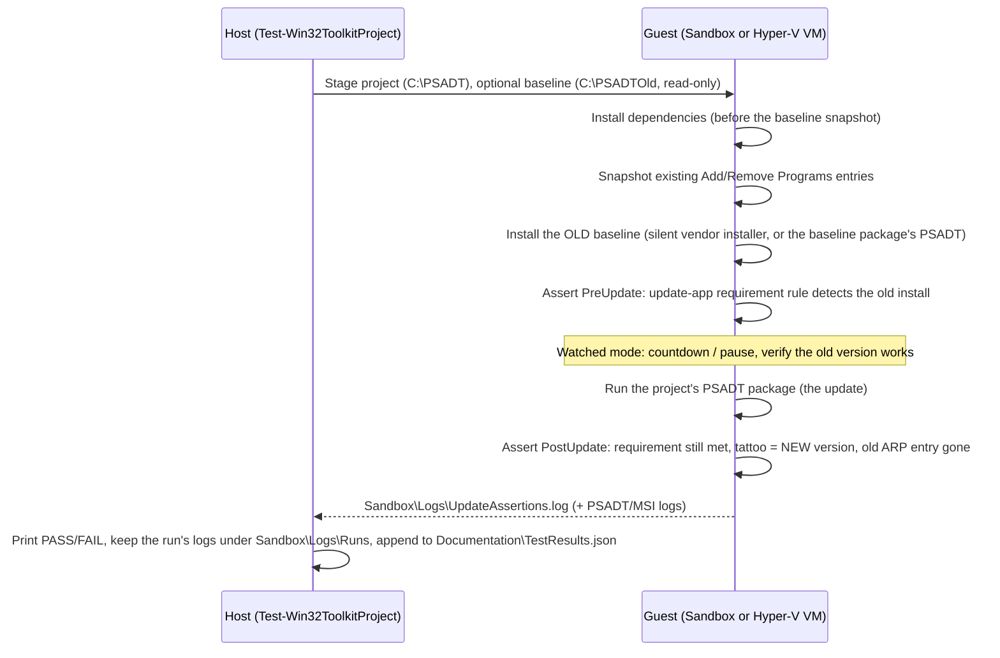

# Testing packages

Before a package ever reaches a device, you can prove it installs, uninstalls, and updates cleanly, in a
disposable Windows guest, with real pass/fail assertions. The command that does this is
[Test-Win32ToolkitProject](reference/Test-Win32ToolkitProject.md); it can run standalone against any
existing project, or be chained onto a packaging run with `Invoke-Win32Toolkit -RunTest`.

Every test run ends with a recorded **PASS / FAIL / inconclusive** verdict in the project's
`Documentation\TestResults.json`, the same history the generated customer documentation reports.

## Test backends: Windows Sandbox vs Hyper-V VM

Tests run in one of two guest environments:

| | **Windows Sandbox** (default) | **Hyper-V test VM** (opt-in) |
|---|---|---|
| Setup needed | None (Windows feature) | One-time VM build (see [Hyper-V test VM](hyperv-vm.md)) |
| Guest lifetime | Disposable: a fresh guest cold-boots for every run | Persistent VM, reverted to a warm checkpoint per run (faster) |
| Concurrency | One sandbox at a time (the toolkit waits up to 90 s for a previous one to close) | No single-instance limit from Sandbox |
| Unattended runs execute as | The sandbox's built-in admin user, `-DeployMode Silent` | **SYSTEM**, with the published Intune command line from a 32-bit parent (Intune parity) |

To make Hyper-V the default backend, set the `TestBackend` config value (stored in the toolkit's
per-user registry key):

```powershell
Set-ItemProperty -Path 'HKCU:\Software\CloudFlow\win32-toolkit' -Name TestBackend -Value 'HyperV'
```

You can also pick a backend for a single run with the `-Backend` parameter. Either way, if Hyper-V is
selected but not ready (not elevated, VM or checkpoint missing, no guest credential saved), the run
**falls back to Windows Sandbox with a warning** instead of failing. Documentation capture follows the
same backend choice.

## Watched vs unattended

Both backends run **watched** (interactive) by default: you get a verification window (a 2-minute
countdown dialog in the Sandbox, or a host-side pause on Hyper-V) to click around in the freshly
installed app before the test continues. In the Sandbox the guest window stays open afterwards for
manual inspection. Which PSADT dialogs you see differs per backend:

- **Sandbox** runs the package in PSADT's **Auto** mode, like Intune does. On PSADT 4.2 the dialogs
  appear only when one of the app's processes-to-close is running; otherwise the run is silent. On
  4.1 an app with an empty processes-to-close list still shows them. (See
  [when dialogs appear](org-templates.md#when-dialogs-appear).)
- **Hyper-V** watched runs force `-DeployMode Interactive`, so the dialogs always show.

Pass `-Unattended` for back-to-back automation:

- No countdown, no pauses.
- **Sandbox**: PSADT runs with `-DeployMode Silent`, and the guest **shuts itself down** after
  collecting logs, so a chained run (for example `-RunTest InstallUninstall, Update`) proceeds without
  anyone closing windows.
- **Hyper-V**: the install, the uninstall and the update run as an **Intune-parity** phase: the exact
  published command line (`Invoke-AppDeployToolkit.exe -DeploymentType Install` or `Uninstall`, no
  deploy mode) started from a 32-bit `cmd.exe`, as SYSTEM, in the package folder, the way the Intune
  Management Extension starts it. Its exit code is checked against Intune's success codes (0, 1707,
  3010, 1641).

To make unattended the default per backend, set the `SandboxTestMode` and/or `HyperVTestMode` config
value to `Unattended` in the same registry key. An explicit `-Unattended` switch always overrides the
config. On a **non-interactive host** (CI pipeline, redirected stdin), the toolkit auto-selects
Unattended and prints a loud warning. Interactive mode would block forever on prompts nobody can see.

> **Context caveat.** A Sandbox-unattended run executes as the sandbox's interactive admin user, while a
> HyperV-unattended run executes as **SYSTEM, with the same launcher, bitness and command line Intune
> uses on a real device**. The two verdicts are therefore *not equivalent evidence*: an app that behaves
> differently under SYSTEM (per-user shortcuts, HKCU writes, user profile paths) can pass in the Sandbox
> and still fail via Intune. The recorded outcome includes the backend and mode so you can tell them
> apart later. For the closest-to-Intune signal, use the Hyper-V backend unattended. (It does not force
> a signed-in desktop. If a user is signed in to the VM, PSADT's Auto mode can still show a dialog, for
> example for a PSADT 4.1 app with an empty processes-to-close list, and the run then waits until the
> runner's 25-minute timeout, recorded as exit code 1460.)

### One package, one process

Every PSADT package in a test (each `project:` dependency, an Update baseline project, and the app
itself) runs in its **own** Windows PowerShell process: PSAppDeployToolkit 4.2 refuses to load a second
copy of itself into one process, and 4.1 and 4.2 packages cannot share one. The app, the baseline and
the update are started by the guest runner `Sandbox\Invoke-PsadtPackage.ps1`, which records the exact
exit code of each run in `Sandbox\Logs\PsadtExitCodes.log`, for example:

```text
[2026-10-16 10:12:03] app Install parent=x86-cmd exit=0 result=Success
```

`parent=x86-cmd` marks an Intune-parity run, `parent=x64-direct` a direct run. Each test run starts its
lines with a `-- test run <name> --` line. The host prints the lines of the run that just ended, and the
Sandbox countdown banner reports the real install result of the current run (green on success, red with
the exit code on failure) instead of always claiming success. The file is emptied when a test command
starts, so after a `-BaselineInstallerType Both` test it holds the lines of every run.

### Each run keeps its own logs

The guest writes its logs to `Sandbox\Logs\`, and the next run overwrites them. So after every run (and
every run of a `-BaselineInstallerType Both` test) the toolkit copies the files that run wrote or changed
into a folder of its own:

```text
Sandbox\Logs\Runs\20261020-221500_InstallUninstall\
Sandbox\Logs\Runs\20261020-222900_Update_msi\
Sandbox\Logs\Runs\20261020-224100_Update_exe\
```

The folder name is the start time, the scenario and, for an Update run, the old version's installer family.
It holds the assertion log, the Add/Remove Programs snapshots, the run's own `PsadtExitCodes.log` lines and
the PSADT and MSI logs. The host prints it as `Run logs : <folder>`, and the run's record in
`Documentation\TestResults.json` names it in `LogFolder`. The files directly in `Sandbox\Logs\` are always
the latest run's. In Windows Sandbox, the toolkit waits up to 60 seconds after the verdict for the guest to
finish copying its logs; a Hyper-V run copies them back before the verdict. The run folders stay on the host:
a Hyper-V run neither copies them into the VM nor brings them back. Like the rest of `Sandbox\`,
these folders are never packaged.

## The InstallUninstall scenario

To run it:

```powershell
Test-Win32ToolkitProject -ProjectPath 'C:\Win32Apps\Projects\Contoso\Git_x64_2.53.0' -Scenario InstallUninstall
```

What happens inside the guest, in order:

1. **Dependencies install first**: any winget or `project:` dependencies the project declares are
   staged into `Sandbox\Dependencies\` and installed silently before the app, the same order Intune
   uses on a real device. The dependency step stops at the first failing dependency and reports its
   exit code.
2. **Install**. The project's package runs in its own process (see
   [Watched vs unattended](#watched-vs-unattended) for the mode).
3. **Assert: installed**. The guest checks that the app is *detected* using the same signal Intune's
   detection rule uses: the **install tattoo** (the registry key the package writes on success). If the
   install "succeeded" but the tattoo is missing, the test fails, exactly as Intune would report a
   failed install. For an MSI it also checks that Windows Installer registered the MSI's product code.
4. **Countdown / verification window** (watched mode only): a 2-minute WinForms countdown with a Skip
   button (Sandbox), or the PSADT GUI plus a host pause (Hyper-V). Use it to launch the app and check it
   actually works.
5. **Uninstall**: the same package with `-DeploymentType Uninstall`, again in its own process.
6. **Assert: uninstalled**. The detection signal (and, for an MSI, the product code) must now be
   *gone*.
7. **Log collection**. PSADT and MSI logs are copied back to the project's `Sandbox\Logs\` folder for
   troubleshooting, whatever the outcome, and kept in the run's own folder
   (see [Each run keeps its own logs](#each-run-keeps-its-own-logs)).

The host waits for the in-guest assertion log (`Sandbox\Logs\InstallAssertions.log`), prints a
**PASS/FAIL verdict**, and appends the outcome (scenario, backend, mode, verdict, timestamp) to
`Documentation\TestResults.json`. In watched Sandbox mode the guest stays open; closing it early before
the uninstall assertion leaves the verdict inconclusive.

<!-- SCREENSHOT: Windows Sandbox during an InstallUninstall run, with the 2-minute countdown dialog visible over the freshly installed app -->

## The Update scenario

The Update scenario proves the package can upgrade a machine that already has an **older version**
installed: the situation your update app meets in the field.

```powershell
Test-Win32ToolkitProject -ProjectPath 'C:\Win32Apps\Projects\Contoso\Git_x64_2.53.0' -Scenario Update -VersionsBack 1
```

### Choosing the old-version baseline

| Baseline source | How | Best for |
|---|---|---|
| **winget** (default) | The toolkit reads the package ID from the project's YAML, lists older winget versions, and downloads one to `Sandbox\OldVersion\`, picked interactively, or via `-VersionsBack` / `-SpecificVersion`. Silent install switches come from the downloaded manifest; when none are published, installer-type defaults apply (NSIS `/S` · Inno `/VERYSILENT /NORESTART /SP-` · WiX/Burn `/quiet /norestart` · MSI `/qn /norestart`), and only for an **unknown/typeless installer**, where `/S` is a guess, a warning tells you to watch the run. | winget-sourced apps |
| **A local packaged project** | `-BaselineProject 'Contoso\Git_x64_2.52.0'` (a friendly `<Template>\<Name>` reference under `Projects\`) or `-BaselineProjectPath` (full path). The baseline package is mapped **read-only** into the guest at `C:\PSADTOld` (its raw `Projects\` copy is never modified) and installed via *its own* PSADT script, in its own process, so the baseline and the update may use different PSADT versions. | Manual (non-winget) apps, which have no winget version history. Also for proving the **tattoo-overwrite** path: the old package writes its tattoo, and the new one must replace it |

#### Which installer technology the old version uses

Many apps ship the same version as more than one installer technology, for example a vendor EXE (NSIS)
and an MSI. Devices that installed the EXE outside Intune are exactly the ones your MSI update meets, and an
MSI never removes an EXE install: the device ends up with two registrations over one folder. So for a
winget baseline, `-BaselineInstallerType` decides the technology of the old version, and the default
looks for the other one:

| Value | Old version installed as |
|---|---|
| `Auto` (default) | The **other** installer technology winget ships for this app, when there is one (for example the NSIS EXE under a WiX MSI package); otherwise the packaged technology. The other technologies come from `Documentation\IdentityDelta.json`, which the test writes on first use (one lookup of the app's winget-pkgs manifest). When that lookup could not run (offline, rate-limited), the test looks again on the next run; until it succeeds, the packaged technology is used and the line under `Baseline technology` says the other technologies could not be checked. |
| `Both` | One Update run **per technology**, at the same version: the packaged one, then each other one winget ships. Each run has its own verdict, its own `TestResults.json` record and its own log folder; the command returns `$false` when any run failed, `$null` when any run had no verdict, otherwise `$true`. |
| `Packaged` | The packaged technology only. |
| `msi`, `wix`, `burn`, `nullsoft`, `inno`, `exe`, `msix` | Exactly that technology family. |

The technology is printed as `Baseline technology : ...` **before** you pick the version, so you know what
the old version has to ship.

```powershell
# Test the update over every technology winget ships for the previous release
Test-Win32ToolkitProject -ProjectPath 'C:\Win32Apps\Projects\Contoso\Notepad++_x64_8.9.8.1' -Scenario Update -VersionsBack 1 -BaselineInstallerType Both
```

The download rules:

- **The installer type is always pinned.** The types of its family are tried in winget's order (for
  `nullsoft`: `nullsoft`, `burn`, `inno`, `exe`). There is **no unpinned retry** any more, so the baseline
  can never silently be another technology than the one printed. After each `No applicable installer found`
  line from winget, one line names the attempt that comes next.
- **A scope is only a preference.** When the pinned type comes with an explicit scope (the packaged
  manifest's `machine` or `user`), it is tried first; when that version has no installer of that scope, the
  same type is downloaded without a scope, with a warning, and `ScopeRelaxed` is recorded. A scope never
  makes the test fail to download. The installer locale is never pinned.
- **`Auto` falls back loudly.** When the chosen version does not ship the other technology, the run falls
  back to the packaged technology (still pinned) with a warning and records `UsedFallback`. Such a run cannot
  show a technology switch, so [Export keeps warning](publishing.md#warnings-before-you-publish) until a run
  with the other technology passes: pick a version that ships it (`-SpecificVersion`) or pass that type to
  `-BaselineInstallerType`.
- **An explicit type, `Packaged` and each `Both` run never fall back.** When the version has no installer of
  that technology, the run has **no verdict**: it prints a warning, records an `Inconclusive` entry marked
  `Baseline.Unavailable` in `TestResults.json` (listed in the documentation, never treated as a test result)
  and returns `$null`. `Sandbox\OldVersion\` keeps the previous old version: it is replaced only when a
  download succeeds.
- **Windows Sandbox in watched mode** keeps each sandbox open for verification, and only one may run: with
  `Both`, close the previous run's sandbox when the console asks (`Close the Windows Sandbox of the previous
  leg ...`). The next run waits up to 10 minutes, then has no verdict. Unattended runs and Hyper-V runs one
  after the other without help.

`-BaselineInstallerType` applies to a winget baseline only; with `-BaselineProject` /
`-BaselineProjectPath` the baseline package has its own technology.

#### Technology switch warning

When the old install of **another** technology is still registered after the update (the `OldArpGone`
assertion failed and the baseline's family differs from the package's), the test prints:

```text
WARNING: Technology switch: the vendor nullsoft install of v8.8.9 (Notepad++ (64-bit x64), ARP key 'Notepad++') was still registered after the wix package installed. Devices that have the vendor EXE install get two registrations over one folder. Do not publish this package to them; see docs/packaging.md, Installer technology.
```

Treat it as a real problem for the devices that have the other install: rebuild the package with the
[technology they already have](packaging.md#installer-technology), or plan how those devices move from one
technology to the other.

### What the run does



The **requirement-rule assertion** is the key extra: before the update runs, the guest executes the same
requirement script the update app will ship with, and asserts it *detects the real old install*. After
the update it asserts the rule is still met and the install tattoo now holds the **new** version (the
Intune detection rule). If the project has no usable requirement rule yet, pass
`-SkipRequirementCheck`. Those assertions report SKIP while the tattoo assertion still runs.

Assertion results stream back to `Sandbox\Logs\UpdateAssertions.log`; the command reports the verdict
and records it in `TestResults.json`, like the InstallUninstall scenario. An Update record also says which
old version was installed and how, so every verdict can be read with its baseline variant:

| Field | Meaning |
|---|---|
| `Baseline.Version` | The old version that was installed. |
| `Baseline.Source` | `winget` (vendor installer) or `project` (a local packaged project, named in `Baseline.ProjectName`). |
| `Baseline.Mode`, `Baseline.Origin` | The `-BaselineInstallerType` value (`Both` for each run of a `Both` test) and where the technology came from (`Sibling`, `Packaged`, `Explicit`, `Project`). |
| `Baseline.RequestedInstallerType`, `Baseline.InstallerType`, `Baseline.Family` | The type asked for, the type winget delivered and its family (`msi`, `exe`, `msix`). |
| `Baseline.UsedFallback`, `Baseline.FallbackReason` | `Auto` fell back to the packaged technology because the version did not ship the other one. |
| `Baseline.RequestedScope`, `Baseline.Scope`, `Baseline.ScopeRelaxed` | The scope asked for, the scope of the delivered installer, and whether the scope preference was dropped. |
| `Baseline.Unavailable` | No installer of that technology at that version: the record has no verdict and is never judged. |
| `OldArpSurvivors` | When `OldArpGone` failed: the old Add/Remove Programs entries still registered (name, key, registry view). |
| `LogFolder` | The run's own log folder, `Sandbox\Logs\Runs\<run>` (every scenario). When an Update test fails, the console, Export and Publish name the `UpdateAssertions.log` in this folder. |

Records written by older versions of the toolkit have no `Baseline` or `LogFolder`; they are kept as they are.

<!-- SCREENSHOT: Host console showing the Update test verdict block (PASS with the requirement and tattoo assertions listed) -->

## What is "the update app"?

The toolkit publishes each packaged version to Intune **twice**:

1. The **install app**, assigned normally; its detection rule is the install tattoo at the exact
   version.
2. The **update app**: the *same* `.intunewin`, published as a second app whose **requirement rule** is
   a presence check: it is only *applicable* on devices where the app is **already installed** (any
   version). Devices without the app ignore it; devices with an older version see the requirement met
   and the detection rule (exact new version) unmet, so they update.

The requirement rule deliberately checks *presence*, not *version*: the detection rule already pins the
exact version, and a "version ≥ new" requirement would make the update applicable only once it is
already up to date. Presence is established from exact, version-stable signals (the install tattoo key,
the MSI UpgradeCode or product code, or an exact Add/Remove-Programs name), and publishing refuses to
create an update app when no reliable signal exists (it would otherwise target every device).

The Update test scenario above is precisely a rehearsal of this app: it proves the requirement rule
detects a genuine old install and that the update leaves the device in the detected, new-version state.
See [Publish-Win32ToolkitIntuneApp](reference/Publish-Win32ToolkitIntuneApp.md) for publishing it.

## Chaining tests onto a packaging run

You don't have to test as a separate step. [Invoke-Win32Toolkit](reference/Invoke-Win32Toolkit.md)
accepts `-RunTest` with one or both scenarios, executed right after the project is built:

```powershell
# Package, then run both scenarios back-to-back (unattended config recommended)
Invoke-Win32Toolkit -Id 'Git.Git' -Architecture x64 -Force -RunTest InstallUninstall, Update -UpdateVersionsBack 1
```

For the chained Update scenario, `-UpdateVersionsBack` picks the baseline N releases back and
`-UpdateSpecificVersion` pins an exact one (it wins when both are given); omit both to pick
interactively. Chained runs benefit from the single-instance handling: the toolkit waits up to 90 s for
a previous sandbox to close before starting the next one, and unattended sandboxes shut themselves down,
so `InstallUninstall, Update` completes hands-off.
